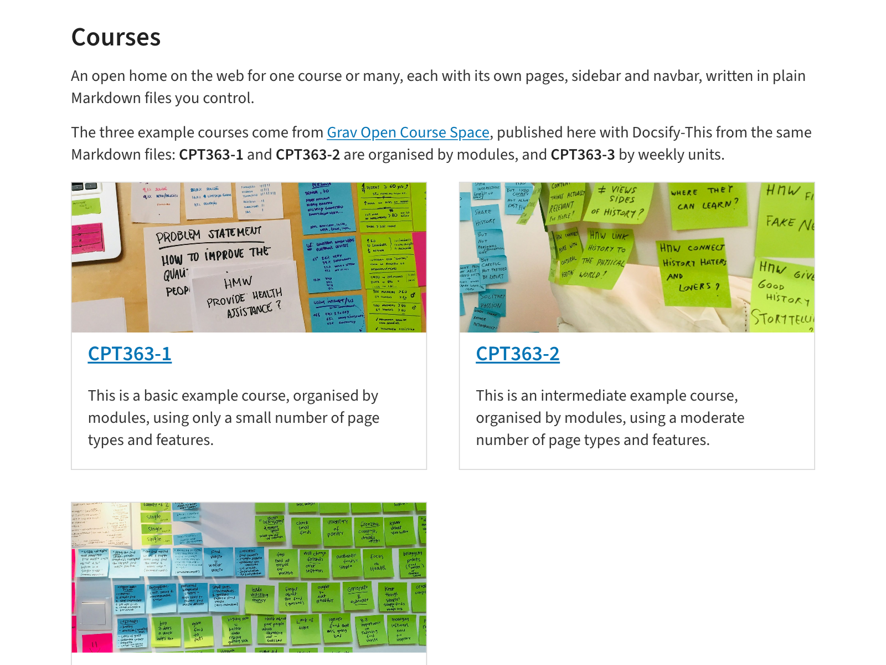

# Docsify-This Multiple Courses Site Template

> This is a multiple courses site template for use with [Docsify-This.net](https://docsify-this.net/#/): a Courses page, and each course with its own home page, modules or weekly units, schedule, resources and syllabus. Its three example courses, **CPT363-1**, **CPT363-2** and **CPT363-3**, come from [Grav Open Course Space](https://github.com/hibbitts-design/grav-skeleton-open-course-space), published from the same Markdown files.

_Figure 1. Docsify-This Multiple Courses Site Template. Explore the resulting standalone web site generated by Docsify-This.net at [https://docsify-this.net/?basePath=https://raw.githubusercontent.com/hibbitts-design/docsify-this-multiple-courses-site/main&homepage=home.md&sidebar=true&loadSidebar=_sidebar.md&loadNavbar=_navbar.md&dark-mode=auto&pagination=true&searchbox=true](https://docsify-this.net/?basePath=https://raw.githubusercontent.com/hibbitts-design/docsify-this-multiple-courses-site/main&homepage=home.md&sidebar=true&loadSidebar=_sidebar.md&loadNavbar=_navbar.md&dark-mode=auto&pagination=true&searchbox=true)_

How to Use
---

1. Sign in to [GitHub](https://github.com), or create an account if you don’t already have one.

2. Tap **Use this template** in this repository (upper-right green button) and then choose **Create a new repository**

3. Choose the name for your new repository to contain the files and then tap **Create repository from template**

4. View an included Markdown file, for example **home.md**, and copy its URL.

5. Go to https://docsify-this.net and paste the copied URL into the **Markdown File URL** field

6. Select the page options you want (e.g. Docsify Sidebar) and tap the **Publish as a Web Page** button to view your Markdown file as a web page for sharing or embedding

> [!NOTE]
> For this template to work as designed, choose **Sidebar** for page layout and, in the **Advanced Web Page Builder Options** section, load the Docsify custom **Sidebar** and **Navbar** files. Each course folder has its own `_sidebar.md` and `_navbar.md`, which load as you move between courses.

To edit a file in GitHub, tap the **Pencil icon** (Edit this file) in the upper-right when viewing the file, make your changes, and then tap the **Commit changes...** button to save those changes.

To load the provided [Docsify custom sidebars](https://docsify.js.org/#/more-pages?id=sidebar) and [Docsify custom navbars](https://docsify.js.org/#/custom-navbar?id=custom-navbar), manually add `&loadSidebar=_sidebar.md&loadNavbar=_navbar.md` to your published Docsify-This URL, for example:
https://docsify-this.net/?basePath=https://raw.githubusercontent.com/hibbitts-design/docsify-this-multiple-courses-site/main&homepage=home.md&sidebar=true&loadSidebar=_sidebar.md&loadNavbar=_navbar.md&dark-mode=auto

Using the ability to change the default values of the Docsify-This Web Page Builder, here are the needed **Sidebar**, **Navbar**, **Previous/Next page buttons** and **Search** options already set - just replace the default Markdown file URL for **home.md** with your own! https://docsify-this.net/?advanced=true&url-field=https://github.com/hibbitts-design/docsify-this-multiple-courses-site/blob/main/home.md&sidebar=true&loadSidebar=_sidebar.md&loadNavbar=_navbar.md&pagination=true&searchbox=true

> [!IMPORTANT]
> To add an edit link, set `edit-link` to your repository (for example `&edit-link=https://github.com/your-name/your-repo`), not to a Markdown file – with a Markdown file, links between the courses stop working.

Add a Course
---

- `home.md` – the Courses page, with a card for each course
- `cpt363-basic/`, `cpt363-intermediate/`, `cpt363-advanced/` – one folder per course: `home.md` (its home page), its modules or weekly units, its other pages (such as `schedule.md`, `resources.md`, `syllabus.md` and `contact.md`), `images/`, `_sidebar.md` (its modules and LMS links) and `_navbar.md` (the course name, All Courses and its other pages)

To add a course:

1. Copy a course folder, such as `cpt363-basic/`, and give it a new name
2. In all of its Markdown files, change `cpt363-basic/` in the links to the new folder name (links start from the site's top folder)
3. Edit its `home.md`, its modules and pages, its `_sidebar.md` and its `_navbar.md`
4. Add a card for it to `home.md`, linking to its `home.md`

> [!TIP]
> Each course's images go in its own `images/` folder.

Docsify-This Examples
---

Multiple Courses Site [home.md](https://github.com/hibbitts-design/docsify-this-multiple-courses-site/blob/main/home.md) file displayed by Docsify-This as:
* [Standalone Site with a Docsify Sidebar and Navbar for each course, and Search](https://docsify-this.net/?basePath=https://raw.githubusercontent.com/hibbitts-design/docsify-this-multiple-courses-site/main&homepage=home.md&sidebar=true&loadSidebar=_sidebar.md&loadNavbar=_navbar.md&dark-mode=auto&searchbox=true "Docsify-This Multiple Courses Site - Standalone Site with a Docsify Sidebar and Navbar for each course, and Search")
* [Standalone Site with a Docsify Sidebar and Navbar for each course, Pagination buttons and Search](https://docsify-this.net/?basePath=https://raw.githubusercontent.com/hibbitts-design/docsify-this-multiple-courses-site/main&homepage=home.md&sidebar=true&loadSidebar=_sidebar.md&loadNavbar=_navbar.md&dark-mode=auto&pagination=true&searchbox=true "Docsify-This Multiple Courses Site - Standalone Site with a Docsify Sidebar and Navbar for each course, Pagination buttons and Search")
* [Standalone Site with a Docsify Sidebar and Navbar for each course, Pagination buttons, Search, Website name and a 'Source Markdown Files' link](https://docsify-this.net/?basePath=https://raw.githubusercontent.com/hibbitts-design/docsify-this-multiple-courses-site/main&homepage=home.md&sidebar=true&loadSidebar=_sidebar.md&loadNavbar=_navbar.md&dark-mode=auto&pagination=true&searchbox=true&name=Open%20Course%20Space%20Courses&edit-link=https://github.com/hibbitts-design/docsify-this-multiple-courses-site&edit-link-text=Source%20Markdown%20Files "Docsify-This Multiple Courses Site - Standalone Site with a Docsify Sidebar and Navbar for each course, Pagination buttons, Search, Website name and a 'Source Markdown Files' link")
